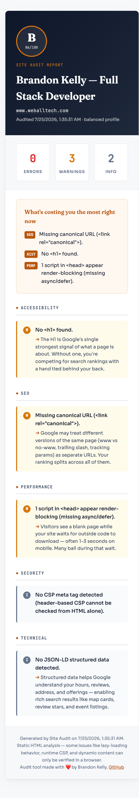

# @bkness/site-audit

> Fast, opinionated website audit — SEO, accessibility, performance, security. Generates a beautiful HTML report with plain-English impact for every finding.

[](https://www.npmjs.com/package/@bkness/site-audit)
[](https://nodejs.org)
[](https://opensource.org/licenses/MIT)

Audit any live URL and get a portable, print-ready HTML report that tells a business owner exactly what's broken, who it hurts, and what it costs — no jargon.



*Sample report — I audited my own portfolio. B (86/100): 3 fixable warnings, zero errors. The tool doesn't hide from itself.*

## Quick start

```bash
npx @bkness/site-audit https://example.com
```

Report is written to `./reports/<domain>-<timestamp>.html`. Open it in a browser, or attach it to an email.

## What you get

- **Letter grade (A–F)** based on severity-weighted findings
- **"What's costing you the most right now"** — top 3 issues surfaced automatically
- **5 categories:** Accessibility, SEO, Performance, Security, Technical
- **33+ rules** with plain-English impact explanations
- **Confidence labels** — the tool tells you when it's guessing vs certain
- **Print-ready** — clean styling for PDFs and printouts

## Profiles

Different sites need different strictness. Pick the profile that matches the audit context.

| Profile | Use for | Behavior |
|---------|---------|----------|
| `balanced` *(default)* | Real business audits, client work | Calibrated to reduce false positives on modern sites |
| `strict` | Internal QA, before release | Tighter thresholds, less leniency |
| `enterprise` | Compliance-grade audits | Most aggressive; no brand/lazy-loading passes |

```bash
npx @bkness/site-audit https://example.com --profile strict
```

## Filter noise

Hide info-level findings and focus on what matters:

```bash
# Warnings and errors only
npx @bkness/site-audit https://example.com --min-level warn

# Errors only
npx @bkness/site-audit https://example.com --min-level error
```

## JSON output for pipelines and CI

Pass `--json` to skip the HTML report and output a single JSON object to stdout. Perfect for piping into `jq`, driving custom renderers, or gating CI builds:

```bash
npx @bkness/site-audit https://example.com --json | jq '.grade'
```

**Exit codes** are CI-friendly:
- `0` — clean audit, no errors
- `1` — audit ran fine but found errors (post-`--min-level` filter)
- `2` — the audit itself failed (network error, parse error)

**Gate a build on zero errors:**

```bash
npx @bkness/site-audit https://your-app.vercel.app --min-level error --json > audit.json \
  || { echo "Audit found errors — see audit.json"; exit 1; }
```

**Schema:**

```json
{
  "url": "https://example.com/",
  "auditedAt": "2026-07-16T04:55:21.000Z",
  "profile": "balanced",
  "minLevel": "info",
  "title": "Page title",
  "description": "Meta description...",
  "score": 44,
  "grade": "F",
  "counts": { "error": 3, "warn": 6, "info": 5 },
  "findings": [
    {
      "level": "error",
      "category": "accessibility",
      "rule": "a11y-link-name-missing",
      "message": "2 links missing an accessible name.",
      "confidence": "high-confidence",
      "impact": "Screen readers announce these as just 'link'..."
    }
  ]
}
```

## Show confidence tags

Display whether each finding is `high-confidence` (deterministic from HTML) or `runtime-limited` (can't be verified without a browser):

```bash
npx @bkness/site-audit https://example.com --show-confidence
```

## What gets checked

<details>
<summary><b>Accessibility</b> — 10 rules</summary>

Missing/multiple `<h1>`, heading-level skips, missing `lang` attribute, unlabeled form controls, unnamed links and buttons, images without alt text, iframes without titles, missing `<main>` landmark.

</details>

<details>
<summary><b>SEO</b> — 10 rules</summary>

Missing/oversized `<title>`, missing meta description, canonical URL, viewport, charset, incomplete Open Graph tags, missing Twitter Card, favicon, `noindex` directives, robots meta.

</details>

<details>
<summary><b>Performance</b> — 7 rules</summary>

Render-blocking scripts, excessive scripts/stylesheets, images without lazy loading, oversized single images, oversized total image weight. Actual byte-size probing via HEAD/Range requests with concurrency limits.

</details>

<details>
<summary><b>Security</b> — 4 rules</summary>

Non-HTTPS URLs, mixed HTTP/HTTPS content, unsafe `target="_blank"` links without `rel="noopener"`, missing CSP meta tag.

</details>

<details>
<summary><b>Technical</b> — 5 rules</summary>

Duplicate HTML IDs, broken fragment/anchor links, missing structured data (JSON-LD), currency-detection gaps on commerce pages.

</details>

## Why not Lighthouse?

Lighthouse is great — but the report reads like Lighthouse output because it *is* Lighthouse output. Every audit tool on Product Hunt uses it.

`site-audit` is different:

- **No browser required.** Pure static analysis via `fetch` + HTML parsing. ~2 seconds per audit vs 30–60 seconds for Lighthouse.
- **No Chromium download.** ~23 KB package vs ~200 MB for a Lighthouse setup.
- **Honest about limits.** Rules that can't be verified from HTML alone are tagged `runtime-limited` so you never accidentally cite a false positive.
- **Business language, not audit jargon.** Every finding explains the consequence, not just the technical detail.

Use Lighthouse when you need full runtime metrics (LCP, CLS, TBT). Use `site-audit` when you need a client-ready report in seconds — for internal QA, client deliverables, or lead-gen outreach.

## Limitations

`site-audit` does static HTML analysis. It won't catch:

- Runtime accessibility issues (focus management, ARIA state updates)
- Actual Core Web Vitals (needs a real browser)
- HTTP header-based CSP (only checks the meta tag)
- Client-side-rendered content (fetches raw HTML only)

Findings that fall in these gaps are tagged `runtime-limited` in the report.

## Development

```bash
git clone https://github.com/bkness/site-audit
cd site-audit
npm install
npm run audit https://example.com
```

Available profiles:

```bash
npm run audit                  # balanced (default)
npm run audit:strict           # strict profile
npm run audit:enterprise       # enterprise profile
npm run audit:clean            # min-level warn
npm run audit:debug            # show confidence tags
```

## Add your own CTA to reports

If you're using `site-audit` for client work or lead-gen, you can inject a "Want these fixed?" call-to-action block on every generated report by setting four environment variables:

```bash
export SITE_AUDIT_CTA_HEADING="Want these fixed?"
export SITE_AUDIT_CTA_BODY="I build and ship fixes for exactly what's flagged above."
export SITE_AUDIT_CTA_LINK_TEXT="Get a free consult →"
export SITE_AUDIT_CTA_LINK_URL="https://your-consulting-site.com"

npx @bkness/site-audit https://client-site.com
```

All four must be set — partial configuration is skipped so a broken pitch never ships. The block appears above the footer and hides on print / PDF export.

## Sponsor

If `site-audit` saved you a Lighthouse setup or shipped a fix on a client site, consider sponsoring:

- **[GitHub Sponsors](https://github.com/sponsors/bkness)** — recurring or one-time, direct to the maintainer.
- **[Hire me](https://brandon-kelly.netlify.app)** — freelance web audits, fixes, and full builds. If the report flagged something you'd rather not fix yourself, I can do it.

Sponsors are recognized in [SPONSORS.md](./SPONSORS.md) (when there are some to recognize 🙂).

## License

MIT © [Brandon Kelly](https://github.com/bkness)
